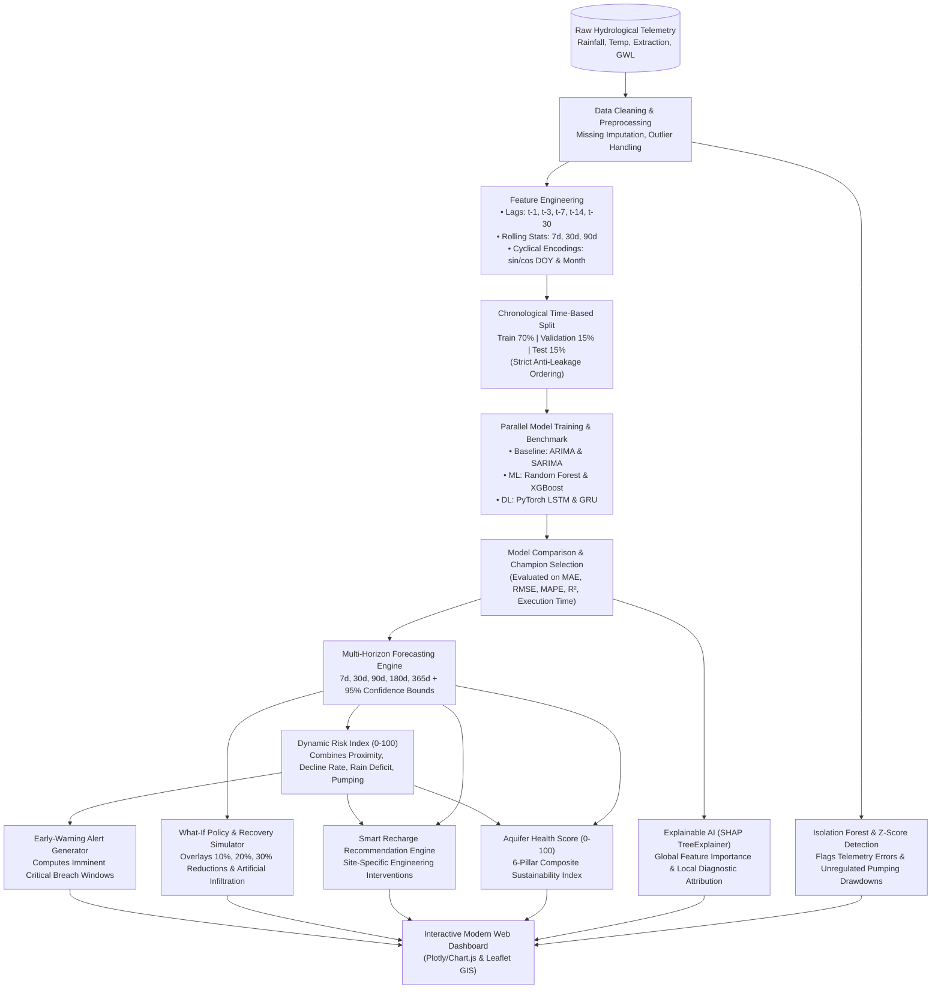
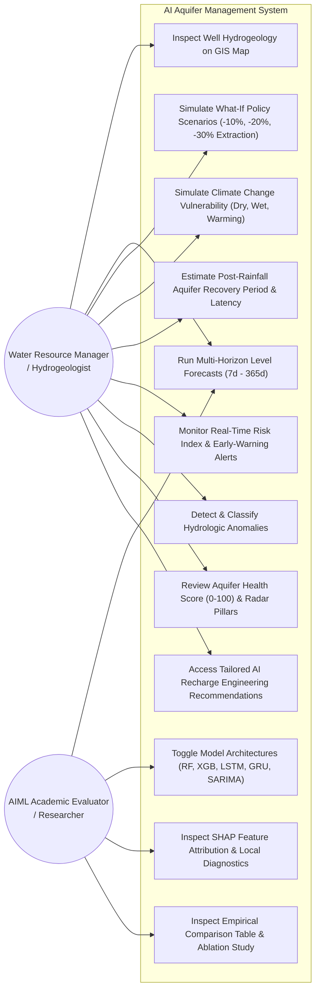

# System Architecture, Data Flow & UML Design Specifications

**Project Title:** AI-Powered Aquifer Groundwater Level Forecasting, Risk Assessment and Smart Water Management System  
**Discipline:** Final-Year Artificial Intelligence & Machine Learning (AIML) Capstone Engineering  

---

## 1. High-Level System Architecture

The platform follows a decoupled, multi-tiered architecture combining a high-performance **Python FastAPI** backend with an asynchronous scientific modeling engine, PyTorch neural networks, tree ensembles, explainable AI pipelines, and a reactive **Web Dashboard**.

```mermaid
graph TB
    subgraph Client_Layer ["Client Presentation Tier (Modern Web Dashboard)"]
        UI_Overview["Basin GIS Monitoring Map (Leaflet.js)"]
        UI_Forecast["Multi-Horizon Forecasting Studio (Chart.js)"]
        UI_Simulator["What-If Multi-Scenario Policy Simulator"]
        UI_Risk["Groundwater Risk Index & Early-Warning Center"]
        UI_XAI["Explainable AI (SHAP Waterfall Attribution)"]
        UI_Anomaly["Isolation Forest Anomaly Detection Lab"]
        UI_Health["Aquifer Health Score (0-100) & Radar"]
        UI_Recs["AI Recharge & Conservation Guidance"]
    end

    subgraph API_Gateway ["Backend Application & API Gateway (FastAPI)"]
        Router_Wells["/api/wells (GIS Coordinates & Metadata)"]
        Router_Forecast["/api/forecast (7d, 30d, 90d, 180d, 365d)"]
        Router_Sim["/api/simulation/what-if & /climate & /recovery"]
        Router_Risk["/api/risk & /api/health-score"]
        Router_XAI["/api/xai/importance & /explain"]
        Router_Anom["/api/anomalies"]
        Router_Research["/api/models/comparison & /ablation"]
    end

    subgraph AI_Core ["AI / ML Analytical & Decision Core"]
        Suite["AquiferForecastingSuite"]
        RF["Random Forest Regressor (Champion)"]
        XGB["XGBoost Gradient Boosting"]
        RNN_LSTM["Deep LSTM Recurrent Network (PyTorch)"]
        RNN_GRU["Deep GRU Recurrent Network (PyTorch)"]
        Baseline["ARIMA & SARIMA Baseline Engines"]
        XAI_Engine["SHAP TreeExplainer & Local Attribution"]
        IsoForest["Isolation Forest & Statistical Bounds"]
        Risk_Engine["Dynamic Risk Index (0-100)"]
        Health_Engine["Aquifer Health Scorer (6 Pillars)"]
        Rec_Engine["Hydrogeological Decision Rules Engine"]
    end

    subgraph Data_Storage ["Data Persistence & Storage Tier"]
        CSV_Storage["Multi-Well Time-Series Telemetry (5 Stations)"]
        JSON_Meta["Hydrogeological Metadata (Sy, Elevations, Thresholds)"]
        Model_Cache["Model Weights & Serialized State"]
    end

    Client_Layer <-->|RESTful JSON / CORS| API_Gateway
    API_Gateway <--> AI_Core
    AI_Core <--> Data_Storage
```



---

## 2. Comprehensive Data-Flow Diagram (DFD - Level 1)

The following data-flow diagram models the end-to-end ingestion, lag feature extraction, chronological splitting, multi-model execution, risk calculation, and real-time visualization.



---

## 3. UML Use-Case Diagram



---

## 4. UML Component & Class Structure

```mermaid
classDiagram
    class AquiferDataPreprocessor {
        +target_col: str
        +feature_scaler: StandardScaler
        +target_scaler: StandardScaler
        +clean_raw_data(df) DataFrame
        +engineer_features(df) DataFrame
        +time_based_split(df, train_r, val_r) tuple
        +fit_transform_datasets(train_df, val_df, test_df) dict
    }

    class AquiferForecastingSuite {
        +well_id: str
        +models: dict
        +metrics: dict
        +best_model_name: str
        +train_baseline_arima(y_train, y_test)
        +train_baseline_sarima(y_train, y_test)
        +train_random_forest(X_train, y_train, X_test, y_test)
        +train_xgboost(X_train, y_train, X_test, y_test)
        +train_pytorch_rnn(X_train, y_train, X_test, y_test, rnn_type)
        +train_and_compare_all(prepared_data) dict
        +generate_multi_horizon_forecast(recent_df, horizon_days, model_name) dict
        +run_ablation_study(raw_df, preprocessor) dict
    }

    class GroundwaterRiskEngine {
        +critical_threshold_m: float
        +safe_threshold_m: float
        +calculate_risk_index(...) dict
        +generate_early_warnings(...) list
    }

    class WaterManagementSimulator {
        +specific_yield: float
        +simulate_what_if_scenarios(...) dict
        +simulate_climate_scenarios(...) dict
    }

    class GroundwaterRecoveryPredictor {
        +safe_depth_m: float
        +specific_yield: float
        +predict_recovery_trajectory(...) dict
    }

    class AquiferExplainableAI {
        +model: Any
        +explainer: TreeExplainer
        +get_global_importance(X_sample) dict
        +explain_instance(...) dict
    }

    class GroundwaterAnomalyDetector {
        +iso_forest: IsolationForest
        +fit_detect(df) DataFrame
        +get_anomaly_summary(df_detected) dict
    }

    class AquiferHealthScorer {
        +evaluate_aquifer_health(...) dict
    }

    class RechargeRecommendationEngine {
        +generate_recommendations(...) dict
    }

    AquiferForecastingSuite ..> AquiferDataPreprocessor : uses
    AquiferForecastingSuite ..> AquiferExplainableAI : primes
    GroundwaterRiskEngine <.. AquiferForecastingSuite : provides predictions
    WaterManagementSimulator ..> AquiferForecastingSuite : references baseline
